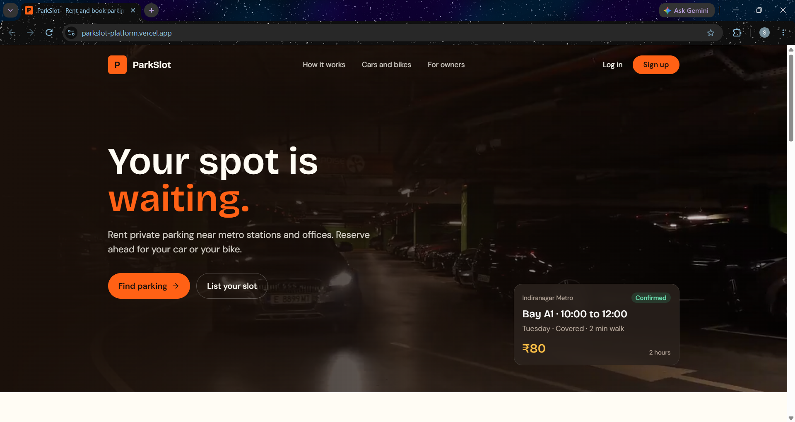
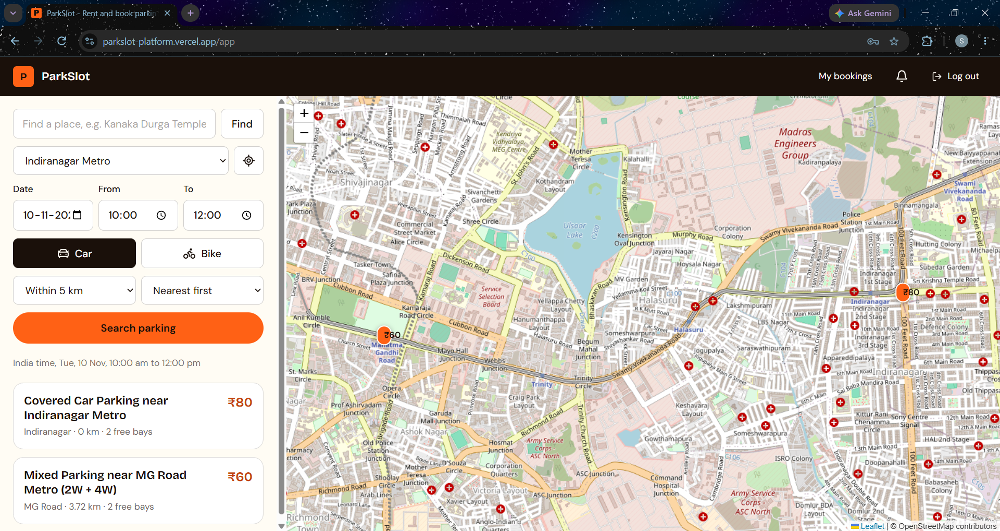
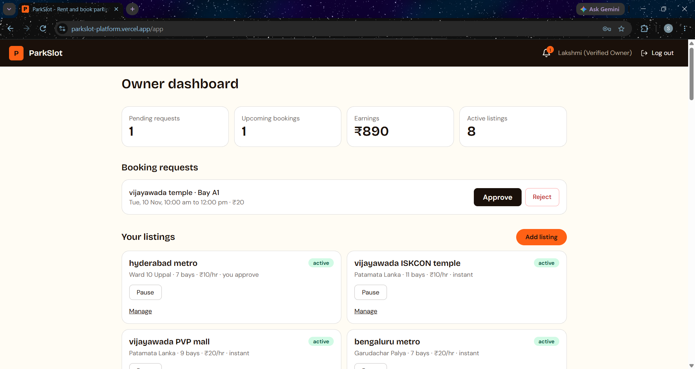
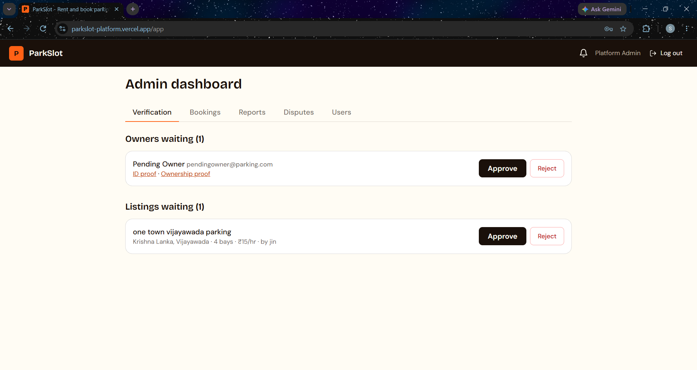
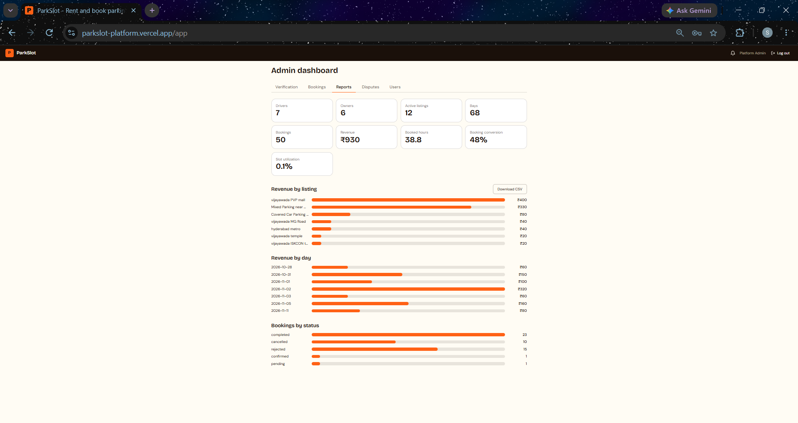

# ParkSlot: Smart Parking Slot Rental and Availability Platform

A web platform where private owners rent out unused parking bays and drivers search, reserve and manage parking near metro stations, offices and commercial areas. Admins verify owners and listings, handle disputes and read reports.

## Live demo

| | Address |
|---|---|
| Website | https://parkslot-platform.vercel.app |
| API | https://parkslot-backend.onrender.com  |

The API runs on a free plan that sleeps when idle. The first request after a quiet period can take about a minute.


| Role | Email |
|---|---|
| Driver | `driver@parking.com` |
| Owner (verified) | `owner@parking.com` |
| Owner (waiting for verification) | `pendingowner@parking.com` |

Admin credentials are available upon request.

## Screenshots

| Landing | Driver Search | Owner Dashboard |
|---|---|---|
|  |  |  |

| Admin Dashboard | Reports |
|---|---|
|  |  |

## Features

**Drivers**
- Register and log in
- Search by place name or device location, date, India-time hours, vehicle type (car or bike) and distance
- Map with price pins, list of results, sort by distance or price
- Reserve a chosen bay in advance
- My bookings with status, cancel, and report a problem
- Notification bell for confirmations and updates

**Owners**
- Submit verification proofs
- Add listings by clicking the map, with bays, opening days and hours, and prices
- Choose automatic or manual approval for each listing
- Approve or reject booking requests, pause or reactivate listings
- Earnings and booking history

**Admins**
- Verify owners and approve listings
- See every booking, filter by status, download CSV
- Resolve disputes with a note
- Reports: users, bookings, revenue by listing and by day, booked hours

**Platform**
- Double booking is prevented through database-level slot locking.
- Times are handled in India Standard Time (UTC+5:30)
- A background job expires requests the owner ignores, and marks bookings active and completed on time
- Role-based access with access and refresh tokens

## How double booking is prevented

Each booking inserts one lock document per bay per India clock hour, inside a database transaction. A unique index on `(slotId, hourStart)` makes a second booking for the same bay and hour fail, and the API answers **409 Slot just taken**. This was tested with six drivers booking the same bay at the same instant: exactly one succeeded.

## Tech stack

| Layer | Technology |
|---|---|
| Frontend | React 18, Vite, Tailwind CSS, Motion, React Router, Leaflet |
| Backend | Node.js, Express |
| Database | MongoDB Atlas, Mongoose |
| Auth | JWT access and refresh tokens, bcrypt |
| Maps | Leaflet with OpenStreetMap tiles, Nominatim place search |
| Hosting | Vercel (frontend), Render (API), Atlas (database) |

## Getting started

**You need:** Node.js 20 or newer, Git, and a free MongoDB Atlas cluster with a database user and your IP address allowed.


### 1. Backend

```bash
cd backend
npm install
```

Create `backend/.env`:

```
PORT=5000
MONGO_URI=mongodb+srv://<user>:<password>@<cluster>.mongodb.net/smartparking?retryWrites=true&w=majority
JWT_SECRET=<a long random text>
ADMIN_PASSWORD=<password for the admin account created by the seed>
```

Load the sample data and start the server:

```bash
node seed/seed.js
npm run dev
```

> The seed script **deletes all data** in the database first. Use it only on a test database.

The server starts on `http://localhost:5000`.

### 2. Frontend

In a second terminal:

```bash
cd frontend
npm install
npm run dev
```

Open `http://localhost:5173`. The frontend talks to `http://localhost:5000/api` by default. To use another address, create `frontend/.env` with `VITE_API_URL=<address>/api`.

### Environment variables

| Name | Where | Meaning |
|---|---|---|
| `MONGO_URI` | backend, required | Atlas connection string including the database name |
| `JWT_SECRET` | backend, required | Secret used to sign tokens |
| `PORT` | backend | Server port, default 5000 |
| `ADMIN_PASSWORD` | backend | Password the seed gives the admin account |
| `FRONTEND_URL` | backend | Website address allowed to call the API; all origins are allowed when it is not set |
| `PENDING_EXPIRY_MINUTES` | backend | Minutes before an unanswered request expires, default 120 |
| `VITE_API_URL` | frontend | API address ending in `/api` |

Never commit `.env` files. They are listed in `.gitignore`.

## Project structure

```
smart-parking/
  backend/
    models/        User, OwnerProfile, Listing, Vehicle, Booking, SlotLock, Dispute, Notification
    routes/        auth, search, listings, owner, bookings, disputes, notifications, admin
    services/      booking, pricing, search, time, notify
    middleware/    auth and role guards, validation
    jobs/          expire.js (background job)
    seed/          seed.js
    test/          booking.js
  frontend/
    src/pages/     Landing, Login, Register, Search, MyBookings, OwnerDashboard, NewListing, AdminDashboard
    src/components/ TopBar, Bell, MapView, MapPicker, VerifyBox, AuthShell, Field
    public/        videos and images
```


## Testing

With the backend running, from the `backend` folder:

```bash
node test/booking.js   # booking engine: 35 checks including double-booking races
```

The test uses the database in `backend/.env`, creates its own test bookings and deletes them when it finishes. Use it only against a test database.

## Credits

- Videos and photos: free stock footage from pexels
- Map data: © OpenStreetMap contributors
- Maps library: Leaflet. Icons: Lucide.

## Author

Sri Vidya Thota
